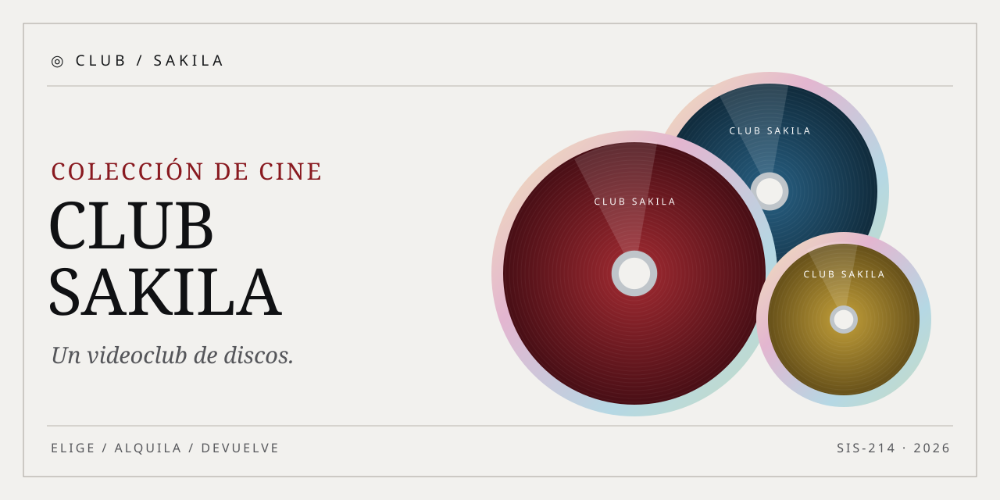
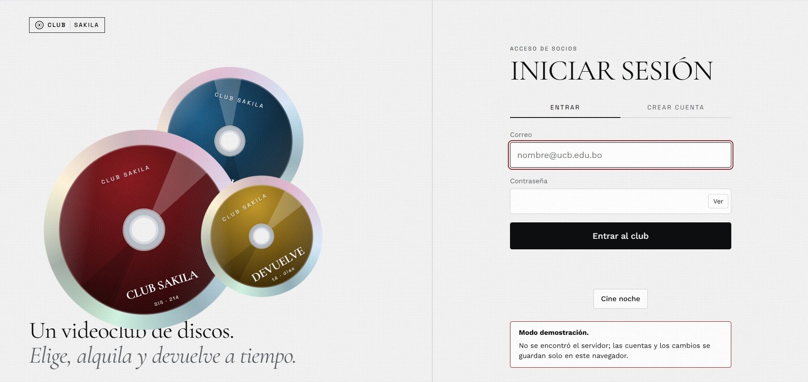
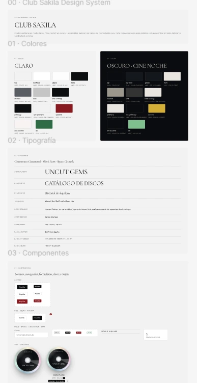
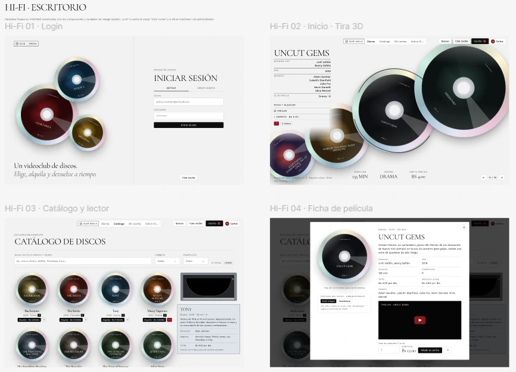
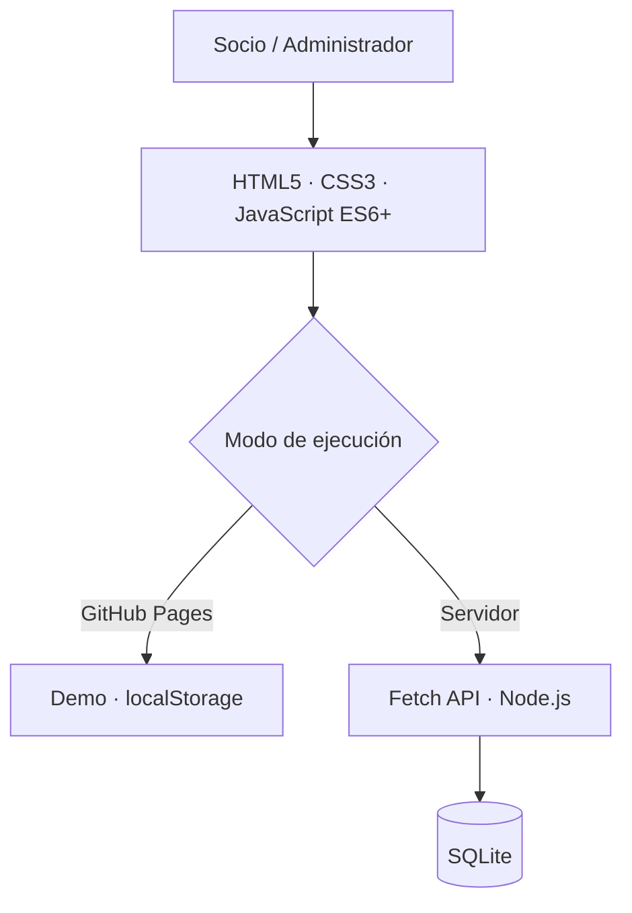

<p align="center"></p>

<p align="center"><strong>Elige, alquila y devuelve a tiempo.</strong></p>
<p align="center">Una experiencia editorial de cine, con un catálogo de discos interactivo y gestión integral de alquileres.</p>
<p align="center">
<a href="https://valrod-sal.github.io/Sakila_VideoClub/">Explorar demo</a> · <a href="#requisitos-e-instalación">Instalación</a> · <a href="#02--diseño-y-documentación">Figma y documentación</a> · <a href="https://drive.google.com/file/d/1JKAcSp1quXbUUPHQAAAgAJwDkajcgPb5/view">Perfil del proyecto (PDF)</a> · <a href="#api-rest">API REST</a>
</p>
<p align="center">
   
</p>

## 01 — La experiencia

Club Sakila transforma el catálogo de películas en una colección de discos navegables. El socio puede descubrir películas, consultar sus fichas, reservar alquileres y gestionar su cuenta; el administrador dispone de un mostrador independiente.



| Socio | Administrador |
| --- | --- |
| Catálogo 3D y filtros dinámicos | Préstamos activos y vencidos |
| Fichas, reparto y tráileres | Registro de devoluciones |
| Carrito con selección de días | Gestión de socios y discos |
| Historial, multas y favoritos | Resúmenes y exportación CSV |

## 02 — Diseño y documentación

| Recurso | Enlace |
| --- | --- |
| Perfil del proyecto | [Consultar documento PDF](https://drive.google.com/file/d/1JKAcSp1quXbUUPHQAAAgAJwDkajcgPb5/view) |
| Design System, Lo-Fi y Hi-Fi | [Prototipo Figma](https://www.figma.com/design/PjMkotdkaep8e3Bfvl0PXL/Club-Sakila-%C2%B7-Prototipo--Design-System--Lo-Fi--Hi-Fi-?node-id=2-4&p=f&t=3c6psznN6vKsk45i-0) |
| Diagramas del sistema | [FigJam](https://www.figma.com/board/AVngDk96KW1SPjGUluepOr/Club-Sakila-%C2%B7-Diagramas-del-sistema--SIS-214-?node-id=0-1&p=f&t=d0RmfCtdCgZE5Hmo-0) |
| Historias de usuario | [Plantilla A](docs/historias-de-usuario.md) |
| Arquitectura | [Descripción técnica](docs/arquitectura.md) |
| Requisitos funcionales | [Trazabilidad del sistema](docs/validacion.md) |
| API, configuración y seguridad | [Manual técnico](docs/manual-tecnico.md) |

<details><summary>Ver Design System y prototipos de escritorio</summary>

 

</details>

## 03 — Arquitectura



El modo demostración guarda los cambios únicamente en el navegador; no equivale a un servicio de autenticación seguro. El modo servidor utiliza API REST y SQLite. El catálogo contiene 15 películas seleccionadas.

## 04 — Guía completa del proyecto

Catálogo de películas presentado como discos: acceso con inicio de sesión, tira 3D interactiva, discos con la portada de cada película, catálogo con lector de discos, ficha con tráiler, carrito de alquiler y cuenta de socio con historial, multas y favoritos. El administrador tiene su propia vista: el mostrador del club, con los préstamos activos y el tiempo que queda para devolver cada disco.

HTML5 semántico · CSS3 modular (Grid/Flex, Custom Properties, transformaciones 3D) · JavaScript ES6+ (módulos, Fetch API) · API REST en Node.js · SQLite.

## Requisitos e instalación

### Requisitos
Node.js **22.13 o superior** (`node -v`). No hay dependencias: no hace falta `npm install`.

Si tienes una base de datos de una versión anterior, ejecuta `npm run db:reset` una vez (la nueva versión agrega contraseñas y sesiones). **Atención:** este comando sustituye los datos existentes por los de ejemplo; respalda los datos que quieras conservar antes de ejecutarlo.

### Cómo correrlo (VS Code)
1. File → Open Folder → esta carpeta.
2. Abre la terminal integrada (Ctrl + `) y ejecuta:
   ```bash
   npm start
   ```
3. Abre http://localhost:3000. Primero aparece la pantalla de inicio de sesión.

### Cuentas para probar
La pantalla de inicio de sesión no muestra cuentas; usa estas cuentas públicas exclusivamente para pruebas locales o de demostración. No las utilices en producción:

| Rol | Correo | Contraseña |
|---|---|---|
| Socio | carlos.mamani@ucb.edu.bo | Sakila2026 |
| Socio | lucia.vargas@ucb.edu.bo | Sakila2026 |
| Socio | andres.choque@ucb.edu.bo | Sakila2026 |
| Administrador | admin@clubsakila.bo | Admin2026 |

También puedes crear una cuenta nueva desde “Crear cuenta”. El socio ve la tienda (tira de discos, catálogo, carrito y su propia cuenta).

El administrador no ve la tienda: entra directo al **mostrador del club**, con
- **Préstamos activos**: quién tiene cada disco, hasta cuándo y cuánto tiempo le queda (o hace cuánto venció), con la multa acumulada y un botón para registrar la devolución.
- **Historial** de todos los alquileres, filtrable por estado.
- **Discos**: quién tiene cada película, cuántas veces se alquiló e ingresos; desde aquí se abre la ficha para cambiar la portada.
- **Socios**: préstamos, vencidos y multas de cada socio, y el formulario para registrar socios nuevos.
- Tarjetas de resumen, búsqueda y exportación del historial a CSV.

### Portadas de los discos (Wikipedia + TMDB opcional)
Las portadas de los CDs se buscan solas en internet; **no hace falta configurar nada**:

1. **TMDB** (opcional, primero si está configurado): crea una cuenta en https://www.themoviedb.org, pide una clave en *Settings → API*, copia `.env.example` como `.env` y pega el **API Read Access Token** en `TMDB_TOKEN` (o la clave v3 en `TMDB_API_KEY`).
2. **Wikipedia** (sin clave, activo por defecto): el servidor busca el artículo de la película (título + año), toma el póster del artículo y lo descarga. Para desactivarlo pon `PORTADAS_WIKIPEDIA=0` en `.env`.

La consola indica qué fuentes están activas, por ejemplo “Portadas de los discos: Wikipedia.”. La primera vez que se pide la portada de una película (`GET /api/portadas/:id`), el servidor la descarga y la guarda en `database/cache/portadas/`; después la sirve desde ahí. Si ninguna fuente la encuentra, el disco se dibuja con sus colores y se reintenta a los 10 minutos.

El administrador también puede **subir su propia imagen** (JPG, PNG o WebP, hasta 3 MB) desde la ficha de la película. Se guarda en `database/portadas/` y tiene prioridad sobre las fuentes de internet. “Restablecer” la quita y vuelve a buscar el póster.

### Tráileres
Cada película tiene su tráiler oficial de YouTube (su disponibilidad depende de YouTube). Si tu base de datos se creó antes de esta corrección, al iniciar el servidor se aplica sola la migración `database/migraciones/001-trailers.sql`; no se pierden alquileres ni socios.

| Comando | Qué hace |
|---|---|
| `npm start` | Inicia el servidor (API + página) en el puerto 3000 |
| `npm run dev` | Igual, pero reinicia el servidor al guardar cambios |
| `npm run db:reset` | Vuelve la base de datos a los datos de ejemplo |
| `npm run demo:build` | Regenera `js/demo-data.js` (con las URLs de los pósteres de Wikipedia) después de editar `database/seed.sql` |

La base (`database/sakila_club.db`) se crea sola la primera vez a partir de `schema.sql` y `seed.sql`.

### Modo demostración (sin servidor)
Si abres la página con Live Server o GitHub Pages, no hay API. La página lo detecta leyendo `js/modo.json` (un archivo estático que dice `servidor: false`; con `npm start` el servidor responde `true`), sin pedir rutas que no existen (así no aparecen errores en la consola), y pasa a **modo demostración**: usa los mismos datos, cuentas y reglas que el servidor (inicio de sesión, validaciones, multas, correos únicos), pero guarda los cambios solo en el navegador (`localStorage`). Un aviso lo indica y permite restablecer los datos. Las portadas se cargan directamente desde Wikipedia; subir imágenes propias necesita el servidor.

Abrir `index.html` con doble clic (`file://`) no funciona: los navegadores bloquean los módulos de JavaScript en ese caso, y la página muestra un aviso con las instrucciones.

## Seguridad del inicio de sesión

Estas medidas corresponden al modo servidor; el modo demostración no ofrece las mismas garantías de seguridad.
- Contraseñas guardadas con PBKDF2-SHA256 (120 000 iteraciones, sal aleatoria); nunca en texto plano.
- Sesión en una cookie `HttpOnly` y `SameSite=Lax` (y `Secure` con HTTPS). En la base solo se guarda el hash del token; la sesión dura 7 días.
- El servidor redirige a `login.html` si no hay sesión, y toda la API (salvo `/api/auth/*`) responde 401 sin ella.
- Cada socio solo accede a su propia cuenta (403 si intenta otra). Las acciones de administrador se comprueban en el servidor.
- Tras 8 intentos fallidos con el mismo correo e IP, el inicio de sesión se bloquea 15 minutos.
- Las peticiones que modifican datos se rechazan si vienen de otro origen.

## Funcionalidades
| Requisito | Dónde |
|---|---|
| RF-01 Buscar y filtrar | Búsqueda en vivo por título, director o reparto (sin distinguir mayúsculas ni tildes) + categoría + clasificación. El filtro afecta a la tira 3D, al índice y al catálogo. |
| RF-02 Ficha | Ventana `<dialog>` con sinopsis, dirección, reparto, tarifa, subtotal según días y tráiler. El disco se voltea con un clic. Tráiler a pantalla completa desde la tira. |
| RF-03 Carrito | Días de 1 a 14, total en vivo, persistencia en `localStorage`. El servidor recalcula los precios con la tarifa de la base. |
| RF-04 Cuenta | Historial con estado (En curso / Vencido / Devuelto), multa de Bs 2.00 por cada día de retraso, devoluciones y favoritos. |
| Registro y acceso | Inicio de sesión y “Crear cuenta” en `login.html`; el administrador también registra socios desde el mostrador. |
| Mostrador (admin) | Préstamos activos con cuenta regresiva y devolución, historial filtrable, disponibilidad y popularidad por disco, resumen por socio, búsqueda y exportación a CSV. |
| Portadas | Póster de cada película en su disco (Wikipedia sin clave, TMDB opcional, o imagen subida por el administrador). |
| Tema | Claro (editorial) y oscuro (“Cine noche”), recordado entre visitas y respetando la preferencia del sistema. |

**Tira 3D:** rueda del ratón (un disco por clic; continuo en trackpad), arrastre, flechas ← →, Inicio/Fin, **Espacio** voltea el disco y **Enter** abre la ficha. Respeta `prefers-reduced-motion`.

## API REST
| Método | Ruta | Descripción |
|---|---|---|
| POST | `/api/auth/login` | Inicia sesión (`email`, `password`) y crea la cookie |
| POST | `/api/auth/registro` | Crea una cuenta de socio e inicia sesión |
| POST | `/api/auth/logout` | Cierra la sesión |
| GET | `/api/auth/sesion` | Usuario de la sesión actual (`null` si no hay) |
| GET | `/api/portadas/:id` | Imagen de la portada (subida, en caché o descargada de TMDB o Wikipedia); 404 si no hay |
| PUT | `/api/portadas/:id` | **Admin.** Sube una portada (cuerpo: la imagen JPG, PNG o WebP) |
| DELETE | `/api/portadas/:id` | **Admin.** Quita la portada subida y la caché; se vuelve a buscar en internet |
| GET | `/api/peliculas?q=&categoria=&clasificacion=` | Catálogo con filtros; `q` busca en título, director y reparto |
| GET | `/api/peliculas/:id` | Ficha de una película |
| GET | `/api/categorias` | Lista de categorías |
| GET / POST | `/api/socios` | **Admin.** Listar o registrar socios (409 si el correo ya existe) |
| GET | `/api/admin/alquileres` | **Admin.** Todos los alquileres con socio, estado y multa (para el mostrador) |
| GET / POST | `/api/socios/:id/alquileres` | Historial (con estado y multa) / confirmar un carrito |
| PATCH | `/api/socios/:id/alquileres/:aid/devolucion` | Registrar devolución (el propio socio o un administrador) |
| GET | `/api/socios/:id/favoritos` | Ids de favoritos |
| PUT / DELETE | `/api/socios/:id/favoritos/:pid` | Agregar / quitar favorito |

## Estructura
```
index.html, login.html
css/       variables, base, layout, components, auth, styles (@import)
js/        main.js (interfaz y arranque según el rol), admin.js (mostrador del administrador), login.js (acceso),
           disc-strip.js (tira 3D), disc.js (disco y utilidades), api.js (cliente Fetch + modo demostración),
           demo-data.js (generado)
server/    server.js (API + archivos estáticos), auth.js (contraseñas y sesiones),
           portadas.js (Wikipedia, TMDB y subidas), db.js (conexión y migraciones), env.js, reset-db.js,
           build-demo-data.js
database/  schema.sql, seed.sql, migraciones/ (cambios para bases ya creadas),
           portadas/ (subidas del admin), cache/ (portadas descargadas)
docs/      historias-de-usuario.md
assets/    icons/disc.svg
```

## Datos
Catálogo de 15 películas: 14 de A24 y *Toy Story 4* (clasificación G), con dirección, reparto, duración, clasificación y enlace de tráiler de YouTube). Cada disco muestra la portada de la película (Wikipedia, TMDB o subida por el administrador); si no hay, se dibuja con CSS a partir de dos colores (`color1`, `color2`). Para cambiar el catálogo edita `database/seed.sql` y ejecuta `npm run db:reset` y `npm run demo:build`.

## Despliegue
GitHub Pages solo sirve archivos estáticos: ahí la página funcionará en modo demostración. Para usar la base de datos real usa **Render**: crea un *Web Service* desde el repositorio (el archivo `render.yaml` ya trae la configuración). Las portadas funcionan sin configurar nada (Wikipedia); si quieres usar TMDB primero, agrega `TMDB_TOKEN` en *Environment*. En el plan gratuito el disco es temporal: la base, las portadas subidas y la caché vuelven a empezar cuando el servicio se reinicia.

## 05 — Proyecto académico

Tecnologías Web I · SIS-214 · Universidad Católica Boliviana · 2026-02.

[Historial de contribuciones](https://github.com/ValRod-Sal/Sakila_VideoClub/graphs/contributors) · [Cambios de versión](CHANGELOG.md) · [Guía de contribución](CONTRIBUTING.md)

El proyecto utiliza recursos cinematográficos de terceros y servicios externos de portadas y tráileres; sus derechos corresponden a sus respectivos titulares. El desarrollo contó con asistencia de IA.
