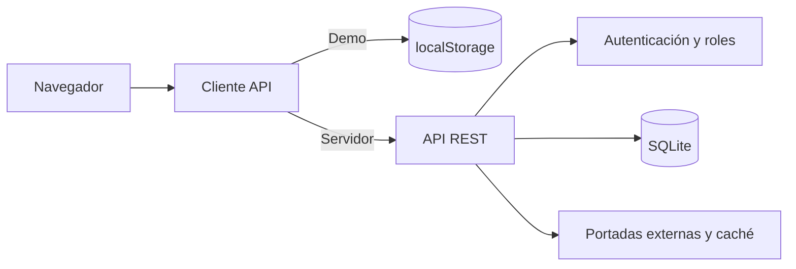

# Arquitectura de Club Sakila

## Capas y responsabilidades

| Capa | Archivos | Responsabilidad |
|---|---|---|
| Presentación | index.html, login.html, css/ | Interfaz semántica, temas, diseño responsivo |
| Interacción (Vue 3) | js/main.js, js/admin.js, js/login.js | App Vue con estado reactivo: filtros, carrito, cuenta, mostrador (composable useMostrador) y acceso |
| Componentes | js/componentes.js, js/disc.js, js/disc-strip.js | Componentes Vue (cd-disco, tira-discos, cuenta-regresiva, tarjeta-stat), discos y navegación 3D |
| Acceso a datos | js/api.js, js/demo-data.js, js/modo.json | Fetch y selección del modo demostración |
| Servidor | server/server.js, server/auth.js, server/portadas.js | API, sesiones, roles y portadas |
| Persistencia | server/db.js, database/schema.sql, database/seed.sql | SQLite, datos iniciales y migraciones |

Consultar [manual técnico](manual-tecnico.md) para rutas, configuración y límites de despliegue. Los diagramas de diseño del equipo se encuentran enlazados en el README.
